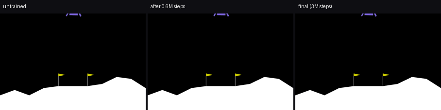
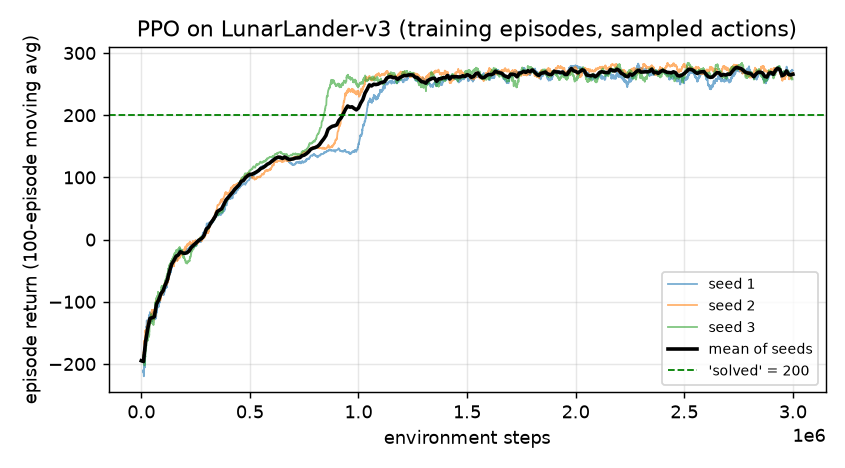

# PPO from scratch: teaching a lander to land

Proximal Policy Optimization (PPO) written from scratch in about 200 lines of PyTorch. It learns to land the
Gymnasium **LunarLander-v3** module using only the reward signal. No RL library is used: the actor-critic
network, rollout collection, Generalized Advantage Estimation and the clipped objective are all in
[`src/ppo.py`](src/ppo.py). Training runs on a laptop **CPU** in about 6 minutes per seed.



## Results

3 independent seeds, 3M environment steps each. Each final policy is tested on **100 episodes with
environment seeds 10000–10099**, which training never used.

| policy | mean return (greedy action) | episodes ≥ 200 | mean return (sampled action) |
|---|---|---|---|
| untrained (random init) | — | — | −183 |
| seed 1 | **281 ± 23** | 98% | 265 ± 62 |
| seed 2 | **275 ± 46** | 97% | 267 ± 60 |
| seed 3 | **272 ± 46** | 96% | 257 ± 73 |
| **mean over seeds** | **276** (seed-to-seed std 3.6) | 97% | 263 |

± is the standard deviation over the 100 test episodes. "Greedy" always takes the most likely action;
"sampled" draws from the policy as it did during training. All three seeds pass the
LunarLander "solved" threshold of 200 by about 1.1M steps.

"Solved" for LunarLander means an average return of 200 or more. A crash costs −100 and a soft landing
between the flags earns +100 to +140, plus points for moving gently and minus points for firing engines.



## How it works, in plain words

The agent sees 8 numbers: position, velocity, angle, angular velocity and whether each leg touches the
ground. Each step it chooses one of 4 actions: do nothing, fire left, fire main or fire right engine.

PPO repeats two phases:

1. **Play.** 16 copies of the game run side by side for 1024 steps each, using the current policy.
   Every state, action, reward and the policy's own probability of that action are recorded.
2. **Learn.** For every step, the agent asks *"did this action turn out better or worse than I
   expected?"* That number is the **advantage**. Actions that turned out better become more likely, worse
   ones less likely. The key PPO idea is **don't change too much at once**: if the new policy's
   probability of an action drifts more than 20% from the old one, the update for that action stops counting.

Two small networks share the work:
- the **actor** (policy) outputs a probability for each of the 4 actions;
- the **critic** estimates how much total reward to expect from a state, which is what "expected" means above.

## The core equations

Probability ratio between the new and the old policy:

$$r_t(\theta) = \frac{\pi_\theta(a_t \mid s_t)}{\pi_{\theta_\text{old}}(a_t \mid s_t)}$$

Clipped surrogate objective (maximised):

$$L^{\text{CLIP}}(\theta) = \mathbb{E}_t\left[\min\big(r_t(\theta)\,\hat A_t,\ \text{clip}(r_t(\theta), 1-\epsilon, 1+\epsilon)\,\hat A_t\big)\right], \quad \epsilon = 0.2$$

Generalized Advantage Estimation (GAE):

$$\delta_t = r_t + \gamma V(s_{t+1}) - V(s_t), \qquad \hat A_t = \sum_{l \ge 0} (\gamma\lambda)^l\, \delta_{t+l}$$

Full loss per minibatch: $-L^{\text{CLIP}} + 0.5\,(V_\theta(s_t) - \hat R_t)^2 - 0.01\,\mathcal{H}[\pi_\theta(\cdot \mid s_t)]$,
where the entropy bonus $\mathcal{H}$ keeps the agent exploring.

## What I learned along the way

- **Hyperparameters matter more than the algorithm.** My first run used short 128-step rollouts and
  γ = 0.99. It reached a return of about +15 and then **fell back to about −50**: the agent learned to hover
  safely instead of landing. Longer rollouts (1024 steps), a longer horizon (γ = 0.999, λ = 0.98) and
  small minibatches of 64 solved it reliably on every seed.
- **Time limits aren't crashes.** When an episode is cut off at 1000 steps, the code bootstraps from
  the critic's value of the final state instead of treating it as "the end", so hovering isn't punished
  like crashing.
- `clipfrac` (the share of samples hitting the clip) and an approximate KL are logged every update,
  so it is easy to see when updates are too large or have died out.

## Reproduce

```bash
git clone https://github.com/Nipuna-Lakruwan/ppo-from-scratch
cd ppo-from-scratch
uv sync
for s in 1 2 3; do uv run python src/ppo.py --seed $s --steps 3000000; done   # ~6 min each on a laptop CPU
uv run python src/evaluate.py                                                  # metrics + figures in results/
uv run pytest                                                                  # unit tests (GAE, shapes)
```

| setting | value |
|---|---|
| parallel envs × rollout length | 16 × 1024 |
| epochs per update, minibatch | 4, 64 |
| learning rate | 3e-4, linear decay to 0 |
| γ, λ, clip ε | 0.999, 0.98, 0.2 |
| entropy / value coefficients | 0.01 / 0.5 |
| network | actor and critic: 2 × 64 tanh MLPs, orthogonal init |

## Resume line

> Implemented Proximal Policy Optimization from scratch in PyTorch (actor-critic, GAE, clipped surrogate objective); it solves LunarLander-v3 with a mean return of 276 over 100 unseen episodes across 3 seeds, trained on a laptop CPU in 6 minutes per seed.

## References

- Schulman et al., *Proximal Policy Optimization Algorithms*, 2017.
- Schulman et al., *High-Dimensional Continuous Control Using Generalized Advantage Estimation*, 2016.
- Huang et al., *The 37 Implementation Details of Proximal Policy Optimization*, ICLR Blog Track 2022.

MIT License.
